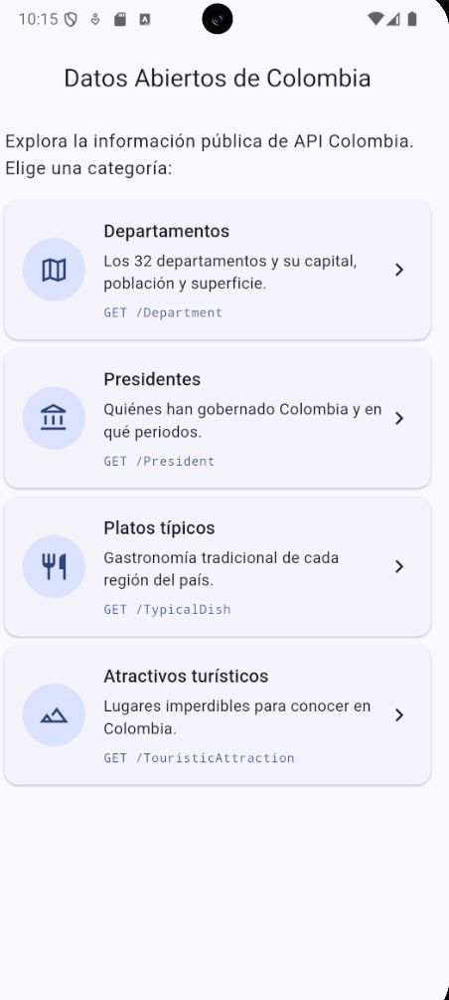
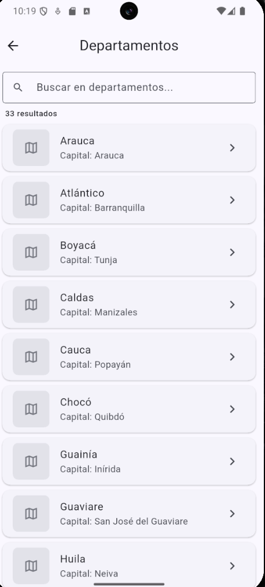
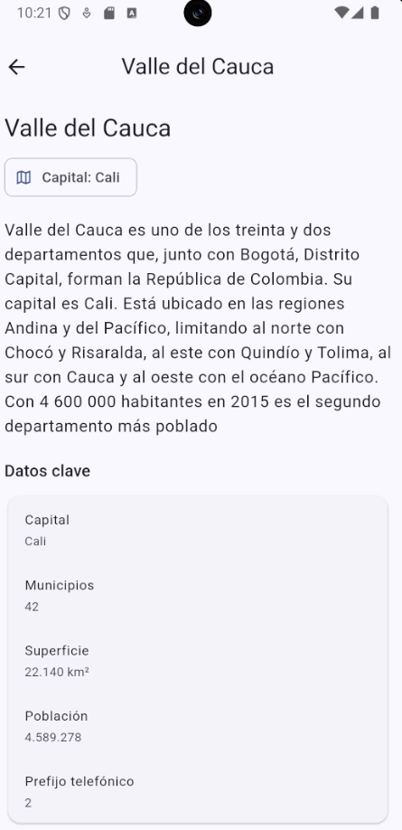
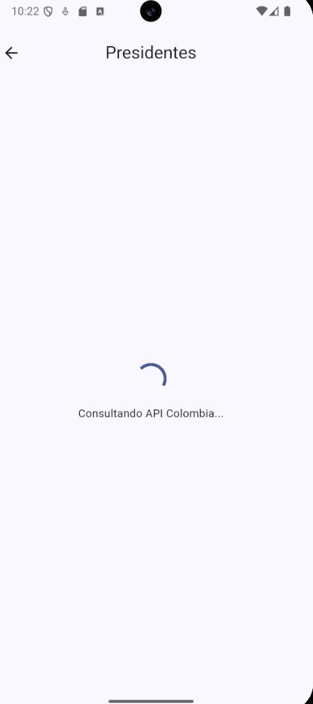
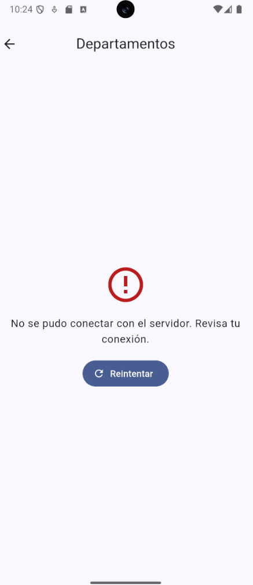

# Datos Abiertos de Colombia (Flutter)

Aplicación móvil desarrollada en Flutter que consume la API pública **API Colombia** y la presenta en tres niveles: un **Dashboard**, un **Listado** y un **Detalle** (maestro-detalle), con navegación por `go_router`, manejo de estados (cargando / éxito / error) y separación por capas.

- Autor: Jhon Alexis Gonzalez Cardenas
- Materia: Desarrollo en Móviles — Unidad Central del Valle del Cauca (UCEVA)
- Repositorio: <https://github.com/Jhon1Alexis1Gonzalez1Cardenas/Curso_moviles_2026-2>
- Versión actual: `1.0.3+3`

## 1. API utilizada

**API Colombia** es una API REST pública y gratuita con información general del país.

- URL base: <https://api-colombia.com/api/v1>
- Documentación (Swagger): <https://api-colombia.com/swagger/index.html>

### Endpoints seleccionados

| Endpoint | Método | Uso en la app |
|---|---|---|
| `/Department` | GET | Listado de departamentos |
| `/Department/{id}` | GET | Detalle de un departamento |
| `/President` | GET | Listado de presidentes |
| `/President/{id}` | GET | Detalle de un presidente |
| `/TypicalDish` | GET | Listado de platos típicos |
| `/TypicalDish/{id}` | GET | Detalle de un plato típico |
| `/TouristicAttraction` | GET | Listado de atractivos turísticos |
| `/TouristicAttraction/{id}` | GET | Detalle de un atractivo turístico |

### Ejemplo de respuesta JSON

`GET https://api-colombia.com/api/v1/Department/31` (descripciones recortadas):

```json
{
  "id": 31,
  "name": "Valle del Cauca",
  "description": "Valle del Cauca es uno de los treinta y dos departamentos ...",
  "cityCapitalId": 1093,
  "municipalities": 42,
  "surface": 22140,
  "population": 4589278,
  "phonePrefix": "2",
  "countryId": 1,
  "cityCapital": {
    "id": 1093,
    "name": "Cali",
    "surface": 619,
    "population": 2545682,
    "postalCode": "760000",
    "departmentId": 31
  },
  "regionId": 2
}
```

## 2. Arquitectura y estructura del proyecto

```
lib/
  config/        configuración general
    env.dart            lee API_BASE_URL del archivo .env (flutter_dotenv)
    api_endpoint.dart   catálogo de endpoints (ruta, título, ícono, parser)
  models/        modelos con fromJson y toJson
    item_api.dart       contrato común (título, subtítulo, imagen, datos)
    department.dart
    president.dart
    typical_dish.dart
    touristic_attraction.dart
    estado_carga.dart   enum Estado { cargando, exito, error }
  routes/
    app_router.dart     configuración de go_router (rutas con nombre)
  services/
    api_colombia_service.dart   todas las llamadas HTTP y manejo de errores
  themes/
    app_theme.dart
  views/         pantallas
    dashboard_view.dart
    listado_view.dart
    detalle_view.dart
    ruta_invalida_view.dart
  widgets/       componentes reutilizables
    dashboard_card.dart, item_card.dart,
    estado_widgets.dart (Cargando / Error), safe_network_image.dart
  main.dart
```

### Decisiones técnicas

- **Servicio separado:** las vistas nunca importan `http`; solo llaman a `ApiColombiaService`. La lógica HTTP vive en `services/` y los modelos en `models/`.
- **Manejo de excepciones y status codes:** el servicio traduce `200`, `404`, `5xx`, timeout (20 s), falta de conexión y JSON inválido a una `ApiException` con un mensaje claro para el usuario.
- **Estados:** cada pantalla que consulta la API usa el enum `Estado` (cargando / éxito / error). En error aparece un botón **Reintentar**.
- **Listado y detalle genéricos:** los cuatro modelos implementan `ItemApi`, así que una sola vista de listado y una sola de detalle atienden todos los endpoints.
- **Imágenes tolerantes:** `SafeNetworkImage` muestra un ícono si la URL es inválida (la API trae algunos valores como `"null"` o texto suelto).
- **Variables de entorno:** la URL base está en `.env`, cargada con `flutter_dotenv`.

## 3. Rutas implementadas con go_router

| Nombre | Ruta | Parámetros | Pantalla |
|---|---|---|---|
| `dashboard` | `/` | — | Dashboard |
| `listado` | `/listado/:tipo` | `tipo` (path): `departamentos`, `presidentes`, `platosTipicos` o `atractivos` | Listado |
| `detalle` | `/listado/:tipo/detalle/:id` | `tipo` y `id` (path); `extra`: título del registro | Detalle |

Ejemplos de navegación:

```dart
// Dashboard -> Listado
context.pushNamed('listado', pathParameters: {'tipo': 'departamentos'});

// Listado -> Detalle (ruta resultante: /listado/departamentos/detalle/31)
context.pushNamed(
  'detalle',
  pathParameters: {'tipo': 'departamentos', 'id': '31'},
  extra: 'Valle del Cauca',
);
```

Si el `tipo` o el `id` no son válidos, el router muestra `RutaInvalidaView`.

## 4. Paquetes utilizados

| Paquete | Para qué |
|---|---|
| `http` | Consumo de la API |
| `go_router` | Navegación y rutas con nombre |
| `flutter_dotenv` | Variables de entorno (URL base) |

## 5. Cómo ejecutar

```bash
flutter pub get
flutter run
```

El archivo `.env` debe existir en la raíz y estar declarado como asset en `pubspec.yaml`:

```yaml
flutter:
  uses-material-design: true
  assets:
    - .env
```

## 6. Capturas

> Reemplaza cada ruta por tu captura (guárdalas en `docs/`).

| Pantalla | Captura |
|---|---|
| Dashboard |  |
| Listado (éxito) |  |
| Detalle |  |
| Estado cargando |  |
| Estado error (con botón Reintentar) |  |

> Tip para la captura de error: activa el modo avión y entra a un listado.

## 7. Distribución con Firebase App Distribution

### 7.1 Flujo

**Generar APK → App Distribution → Testers → Instalación → Actualización**

1. **Generar APK:** se compila el build de release con `flutter build apk --release`.
2. **App Distribution:** el APK se sube a Firebase App Distribution (proyecto *Taller distribucion*) y se asigna al grupo de testers.
3. **Testers:** el grupo `QA_Clase` incluye a `dduran@uceva.edu.co` y al correo institucional del autor. Cada tester recibe un correo de invitación.
4. **Instalación:** el tester acepta la invitación e instala la app en un dispositivo Android físico desde el enlace o desde Firebase App Tester.
5. **Actualización:** se incrementa la versión, se vuelve a compilar y distribuir, y el tester actualiza sobre la instalación existente.

### 7.2 Publicación (cómo replicar el proceso en el equipo)

1. **Versión:** editar `version` en `pubspec.yaml` (ver 7.3).
2. **Permisos:** confirmar que `android/app/src/main/AndroidManifest.xml` declara `<uses-permission android:name="android.permission.INTERNET"/>`, porque la app consume una API.
3. **Archivo `.env`:** debe existir en la raíz del proyecto, porque está declarado como asset (ver sección 5). Si no está en el repo, copiar `.env.example` como `.env` antes de compilar.
4. **Compilar:**
   ```bash
   flutter clean
   flutter pub get
   flutter build apk --release
   ```
   El APK queda en `build/app/outputs/flutter-apk/app-release.apk`.
5. **Firebase Console:** abrir el proyecto, ir a **App Distribution → Versiones** y arrastrar `app-release.apk`.
6. **Grupo y notas:** asignar el grupo `QA_Clase`, escribir las release notes (ver 7.4) y pulsar **Distribuir**.
7. **Enlace:** copiar el enlace de instalación del release.

**Datos de la app en Firebase:**

| Dato | Valor |
|---|---|
| applicationId | `com.example.taller_datos_abiertos` |
| Grupo de testers | `QA_Clase` |
| Tester del curso | `dduran@uceva.edu.co` |

> **Importante para el equipo:** el release se firma con las llaves *debug* de la máquina (`signingConfig = debug` en `build.gradle.kts`). Para que Android acepte una actualización sobre una versión ya instalada, los APK deben compilarse **en el mismo computador**. Si se compila en otra máquina, hay que desinstalar la app antes de instalar o configurar un keystore compartido.

### 7.3 Versionado

El `versionName` y el `versionCode` de Android salen de `pubspec.yaml`, con el formato `version: <versionName>+<versionCode>`:

| Versión | `pubspec.yaml` | Descripción |
|---|---|---|
| 1.0.2 (2) | `version: 1.0.2+2` | Primera distribución |
| 1.0.3 (3) | `version: 1.0.3+3` | Actualización incremental |

El número después del `+` (`versionCode`) debe **aumentar siempre**; si no, Android no reconoce el APK como actualización.

### 7.4 Formato de Release Notes

```
Versión X.Y.Z (build N) - DD/MM/AAAA
Cambios:
- ...
Credenciales de prueba: ...
Responsable: ...
```

**Release notes usadas:**

```
Versión 1.0.2 (build 2) - 03/11/2026
Cambios:
- Primera distribución de la app "Datos Abiertos de Colombia".
- Dashboard con 4 categorías (Departamentos, Presidentes, Platos típicos, Atractivos turísticos), listado y detalle consumiendo API Colombia.
Credenciales de prueba: no aplica (la app no requiere inicio de sesión).
Responsable: Jhon Alexis Gonzalez Cardenas
```

```
Versión 1.0.3 (build 3) - 03/11/2026
Cambios:
- Sin cambios funcionales. Incremento de versión para validar el flujo de actualización incremental (1.0.2 → 1.0.3) en App Distribution.
Credenciales de prueba: no aplica.
Responsable: Jhon Alexis Gonzalez Cardenas
```

### 7.5 Evidencias

> Guarda las capturas en `docs/distribucion/` y ajusta los nombres si es necesario.

| Evidencia | Captura |
|---|---|
| Releases en App Distribution (1.0.2 y 1.0.3) |  |
| Testers con `dduran@uceva.edu.co` |  |
| Correo de invitación |  |
| App instalada y abierta |  |
| Versión instalada antes de actualizar (1.0.2) |  |
| Versión instalada después de actualizar (1.0.3) |  |

## 8. Flujo GitFlow

- Taller API Colombia: `feature/taller_api_colombia` → Pull Request → `dev` → merge a `main`.
- Taller App Distribution: `feature/app_distribution` → Pull Request → `dev` → merge a `main`.