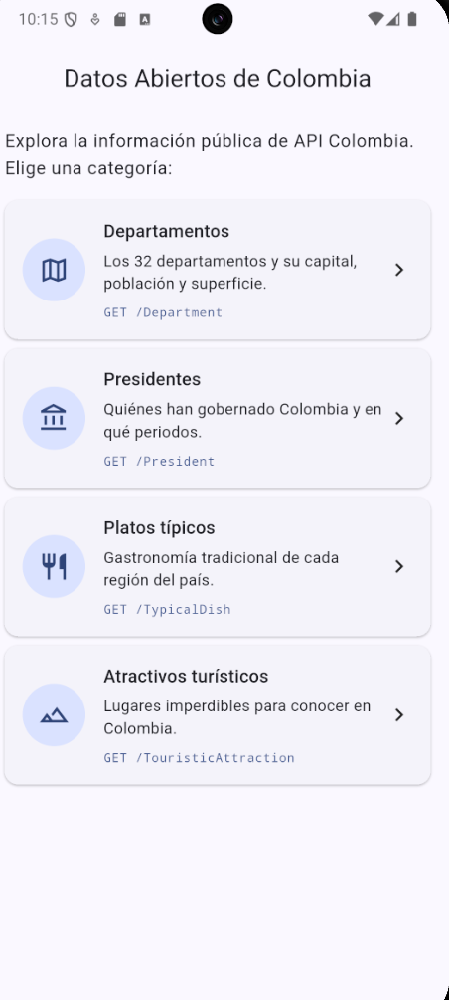
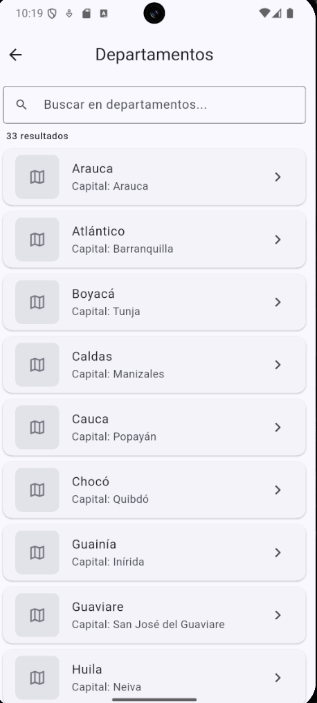
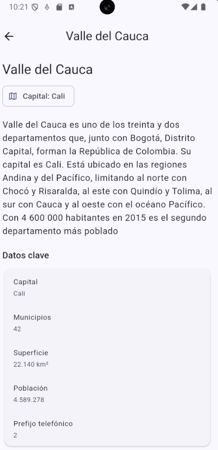
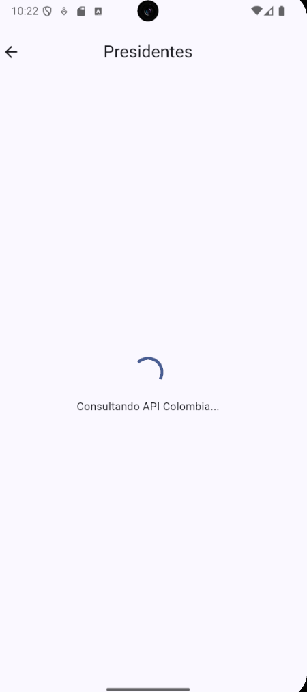
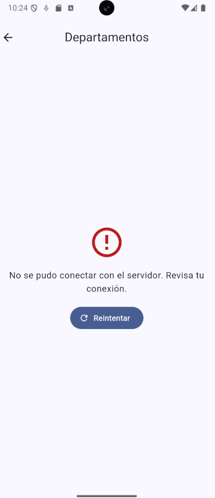

# Datos Abiertos de Colombia (Flutter)

Aplicación móvil desarrollada en Flutter que consume la API pública **API Colombia** y la presenta en tres niveles: un **Dashboard**, un **Listado** y un **Detalle** (maestro-detalle), con navegación por `go_router`, manejo de estados (cargando / éxito / error) y separación por capas.

- Autor: Jhon Alexis Gonzalez Cardenas
- Materia: Desarrollo en Móviles — Unidad Central del Valle del Cauca (UCEVA)
- Repositorio: <https://github.com/Jhon1Alexis1Gonzalez1Cardenas/taller_datos_abiertos> *(ajusta la URL si el repo queda en otra cuenta)*

## 1. API utilizada

**API Colombia** es una API REST pública y gratuita con información general del país.

- URL base: <https://api-colombia.com/api/v1>
- Documentación (Swagger): <https://api-colombia.com/swagger/index.html>

### Endpoints seleccionados

| Endpoint | Método | Uso en la app |
|---|---|---|
| `/Department` | GET | Listado de departamentos |
| `/Department/{id}` | GET | Detalle de un departamento |
| `/President` | GET | Listado de presidentes |
| `/President/{id}` | GET | Detalle de un presidente |
| `/TypicalDish` | GET | Listado de platos típicos |
| `/TypicalDish/{id}` | GET | Detalle de un plato típico |
| `/TouristicAttraction` | GET | Listado de atractivos turísticos |
| `/TouristicAttraction/{id}` | GET | Detalle de un atractivo turístico |

### Ejemplo de respuesta JSON

`GET https://api-colombia.com/api/v1/Department/31` (descripciones recortadas):

```json
{
  "id": 31,
  "name": "Valle del Cauca",
  "description": "Valle del Cauca es uno de los treinta y dos departamentos ...",
  "cityCapitalId": 1093,
  "municipalities": 42,
  "surface": 22140,
  "population": 4589278,
  "phonePrefix": "2",
  "countryId": 1,
  "cityCapital": {
    "id": 1093,
    "name": "Cali",
    "surface": 619,
    "population": 2545682,
    "postalCode": "760000",
    "departmentId": 31
  },
  "regionId": 2
}
```

## 2. Arquitectura y estructura del proyecto

```
lib/
  config/        configuración general
    env.dart            lee API_BASE_URL del archivo .env (flutter_dotenv)
    api_endpoint.dart   catálogo de endpoints (ruta, título, ícono, parser)
  models/        modelos con fromJson y toJson
    item_api.dart       contrato común (título, subtítulo, imagen, datos)
    department.dart
    president.dart
    typical_dish.dart
    touristic_attraction.dart
    estado_carga.dart   enum Estado { cargando, exito, error }
  routes/
    app_router.dart     configuración de go_router (rutas con nombre)
  services/
    api_colombia_service.dart   todas las llamadas HTTP y manejo de errores
  themes/
    app_theme.dart
  views/         pantallas
    dashboard_view.dart
    listado_view.dart
    detalle_view.dart
    ruta_invalida_view.dart
  widgets/       componentes reutilizables
    dashboard_card.dart, item_card.dart,
    estado_widgets.dart (Cargando / Error), safe_network_image.dart
  main.dart
```

### Decisiones técnicas

- **Servicio separado:** las vistas nunca importan `http`; solo llaman a `ApiColombiaService`. La lógica HTTP vive en `services/` y los modelos en `models/`.
- **Manejo de excepciones y status codes:** el servicio traduce `200`, `404`, `5xx`, timeout (20 s), falta de conexión y JSON inválido a una `ApiException` con un mensaje claro para el usuario.
- **Estados:** cada pantalla que consulta la API usa el enum `Estado` (cargando / éxito / error). En error aparece un botón **Reintentar**.
- **Listado y detalle genéricos:** los cuatro modelos implementan `ItemApi`, así que una sola vista de listado y una sola de detalle atienden todos los endpoints.
- **Imágenes tolerantes:** `SafeNetworkImage` muestra un ícono si la URL es inválida (la API trae algunos valores como `"null"` o texto suelto).
- **Variables de entorno:** la URL base está en `.env`, cargada con `flutter_dotenv`.

## 3. Rutas implementadas con go_router

| Nombre | Ruta | Parámetros | Pantalla |
|---|---|---|---|
| `dashboard` | `/` | — | Dashboard |
| `listado` | `/listado/:tipo` | `tipo` (path): `departamentos`, `presidentes`, `platosTipicos` o `atractivos` | Listado |
| `detalle` | `/listado/:tipo/detalle/:id` | `tipo` y `id` (path); `extra`: título del registro | Detalle |

Ejemplos de navegación:

```dart
// Dashboard -> Listado
context.pushNamed('listado', pathParameters: {'tipo': 'departamentos'});

// Listado -> Detalle (ruta resultante: /listado/departamentos/detalle/31)
context.pushNamed(
  'detalle',
  pathParameters: {'tipo': 'departamentos', 'id': '31'},
  extra: 'Valle del Cauca',
);
```

Si el `tipo` o el `id` no son válidos, el router muestra `RutaInvalidaView`.

## 4. Paquetes utilizados

| Paquete | Para qué |
|---|---|
| `http` | Consumo de la API |
| `go_router` | Navegación y rutas con nombre |
| `flutter_dotenv` | Variables de entorno (URL base) |

## 5. Cómo ejecutar

```bash
flutter pub get
flutter run
```

El archivo `.env` debe existir en la raíz y estar declarado como asset en `pubspec.yaml`:

```yaml
flutter:
  uses-material-design: true
  assets:
    - .env
```

## 6. Capturas

> Reemplaza cada ruta por tu captura (guárdalas en `docs/`).

| Pantalla | Captura |
|---|---|
| Dashboard |  |
| Listado (éxito) |  |
| Detalle |  |
| Estado cargando |  |
| Estado error (con botón Reintentar) |  |

> Tip para la captura de error: activa el modo avión y entra a un listado.

## 7. Flujo GitFlow

`feature/taller_api_colombia` → Pull Request → `dev` → merge a `main`.
